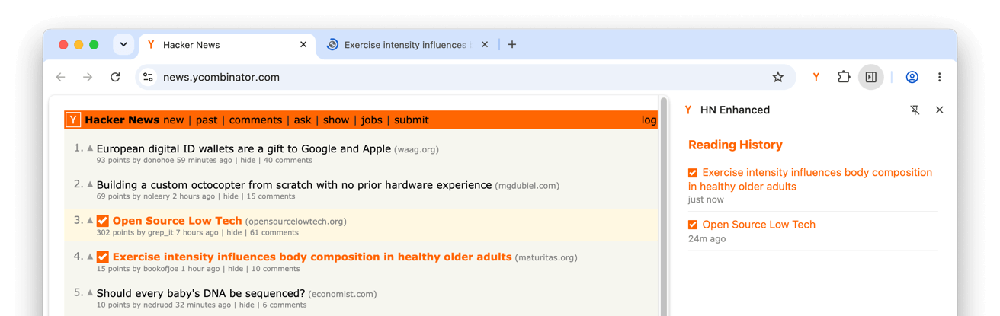

# HN Enhanced

> A Hacker News enhancement extension — built with [WXT Layers](https://github.com/davestewart/wxt-module-layers)



## Overview

This demo extension enhances [Hacker News](https://news.ycombinator.com) with score highlights and read-tracking, with each feature isolated in its own layer:

```yaml
ext/                                # src folder named `ext` to list first
  entrypoints/
    background.ts                   # optional: manually invokes layer backgrounds
  utils/
    constants.ts                    # HN_URL, HN_MATCHES (auto-imported)
    misc.ts                         # timeAgo() helper (auto-imported)

layers/
  theme/                            # visual enhancements
    assets/
      theme.css                     # score highlight styles
    entrypoints/
      background.ts                 # demo only: background execution order
      hn-theme.content.ts           # favicon, new-tab links, score highlights; imports from #tracker
    public/
      icon.svg                      # asset copied to assets/theme/icon.svg
    layer.config.ts                 # sets background execution order

  tracker/                          # read tracking
    entrypoints/
      background.ts                 # opens sidepanel + stores visited stories
      hn-tracker.content.ts         # marks read stories; imports from '..' (barrel)
      tracker.sidepanel/            # reading history panel
        index.html
        main.ts                     # imports check.svg?raw; links to HN comments pages
    stores/
      stories.ts                    # useStoriesStore (auto-imported)
    utils/
      dom.ts                        # getStoryRows, getStoryData, getStoryScore, markStoryRead
    public/
      check.svg                     # asset copied to assets/tracker/check.svg
    layer.config.ts                 # adds store auto-import, storage permission + sidebar action to manifest
    index.ts                        # barrel: re-exports from utils/dom
```

Note: `ext/entrypoints/background.ts` manually calls `main()` from the virtual module — this is optional. Remove the file and the module will create a virtual background entrypoint automatically. See [background scripts](https://github.com/davestewart/wxt-module-layers#per-layer-background-scripts) in the main docs.

## What it demonstrates

| Feature                      | Where to look                                                                                                               |
|------------------------------|-----------------------------------------------------------------------------------------------------------------------------|
| Layer discovery              | `wxt.config.ts` — default source `layers/*`                                                                                 |
| Auto-discovered entrypoints  | Content scripts, background, and sidepanel from layers                                                                      |
| Per-layer background scripts | Both layers have `background.ts` — auto-combined with `ext` background                                                      |
| Background execution order   | `layers/theme/layer.config.ts` — `order: 2`; tracker runs first (`order: 1`)                                               |
| Optional src background      | `ext/entrypoints/background.ts` — manually calls `main()` from virtual module. Delete to run background files automatically |
| Global auto-imports (utils)  | `sidepanel/main.ts` — `HN_URL`, `timeAgo` auto-imported from `ext/utils/`                                                  |
| Layer auto-imports (stores)  | `background.ts`, `sidepanel/main.ts` — `useStoriesStore` auto-imported from `tracker/stores/`                               |
| Barrel file exports          | `layers/tracker/index.ts` — re-exports `getStoryRows`, `getStoryData`, `getStoryScore`, `markStoryRead` from `utils/dom`   |
| Within-layer imports         | `hn-tracker.content.ts` — `import { getStoryRows, getStoryData, markStoryRead } from '..'`                                  |
| Cross-layer barrel import    | `hn-theme.content.ts` — `import { getStoryRows, getStoryScore } from '#tracker'` (theme layer consuming tracker's barrel)  |
| Content script CSS           | `layers/theme/assets/theme.css` — imported by `hn-theme.content.ts`                                                         |
| Asset import (`?raw`)        | `tracker.sidepanel/main.ts` — imports `check.svg?raw` for inline SVG rendering                                             |
| Sidepanel story links        | `tracker.sidepanel/main.ts` — links to `HN_URL/item?id=...` (HN comments page for each story)                              |
| Public file copying          | `layers/*/public/*.svg` → `assets/{name}/*.svg` (via `publicPrefix: 'assets/{name}/'`)                                      |
| Public file access           | `wxt.config.ts` — `publicAccess: HN_MATCHES` restricts files to HN pages (overridable per layer)                            |
| Layer config + manifest      | `layers/tracker/layer.config.ts` — `storage` permission and `action` manifest key                                           |

## Running

```bash
pnpm install
pnpm dev
```

Once loaded:

1. Click the **extension icon** — opens the sidepanel and navigates to HN
2. **Score highlights** — high-scoring stories get a highlighted background
3. Click a story title — it's tracked and **marked immediately** with a checkmark and orange highlight
4. The **sidepanel** updates live with your reading history

Check the service worker console — both layer backgrounds run in order:

```
▸ [wxt-layers]
    ▸ tracker.background:
        [tracker] Background initialized
    ▸ theme.background:
        [theme] Background initialized
```

## Configuration

The full config in `wxt.config.ts`:

```ts
export default defineConfig({
  modules: ['wxt-module-layers'],

  layers: {
    // default source is layers/*, no need to configure sources
    publicAccess: HN_MATCHES,        // restrict public files to HN pages (overridable per layer)
    publicPrefix: 'assets/{name}/',  // copy public files to assets/<name>/
    logLevel: 'debug',
  },

  // place core files in ext (vs src) so files are co-located and listed first 
  srcDir: './ext',

  manifest: {
    name: 'HN Enhanced',
    description: 'A Hacker News enhancement extension — built with WXT Layers',
  },

  runner: {
    startUrls: ['https://news.ycombinator.com'],
  },
})
```

Set `logLevel: 'debug'` to see what the module discovers at build time.

## Output

The build output reflects decisions made in layer configs and `wxt.config.ts`:

```yaml
.output/chrome-mv3/
  assets/                       # thanks to publicPrefix: 'assets/{name}/'
    theme/
      icon.svg                  # copied from layers/theme/public/
    tracker/
      check.svg                 # copied from layers/tracker/public/
  background.js
  content-scripts/
    hn-theme.content.js
    hn-theme.content.css
    hn-tracker.content.js
  tracker.sidepanel.html
  manifest.json
```

Key manifest entries (simplified):

```json5
{
  // added by layers/tracker/layer.config.ts (could also go in wxt.config.ts)
  "permissions": [
    "storage"
  ],

  // added by layers/tracker/layer.config.ts — enables the sidebar action button
  "action": {},

  "web_accessible_resources": [
    // theme overrides publicAccess for broader favicon access
    {
      "matches": ["<all_urls>"],
      "resources": ["/assets/theme/icon.svg"]
    },

    // inherits publicAccess: HN_MATCHES from wxt.config.ts
    {
      "matches": ["*://news.ycombinator.com/*"],
      "resources": ["/assets/tracker/check.svg"]
    }
  ]
}
```
